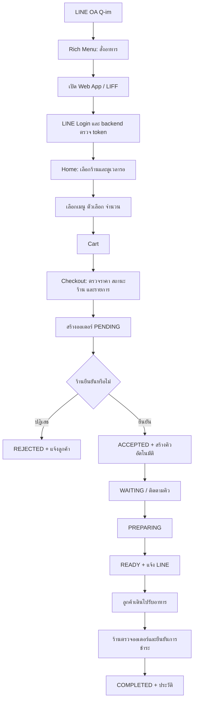
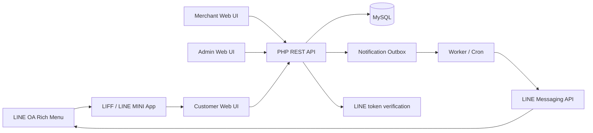

# Q-im — Project Context & Development Instructions

> ไฟล์นี้เป็นเอกสารหลักสำหรับ Claude / Claude Code เพื่อทำความเข้าใจโปรเจกต์ก่อนวางแผนหรือแก้ไขโค้ด อ่านทั้งไฟล์ก่อนเริ่มงาน และตรวจสอบ repository จริงก่อนสรุปว่าส่วนใดสร้างเสร็จแล้ว

## 1. Project Overview

- Project name: **Q-im (คิวอิ่ม)**
- Product: Smart Food Court Platform — Food Ordering + Smart Queue + Self Pickup + LINE Integration
- เป้าหมาย: ลดความแออัดและการยืนรออาหารในโรงอาหาร โดยให้ลูกค้าสั่งอาหารล่วงหน้าและเดินไปรับเมื่ออาหารพร้อม
- UX: คล้ายแอปสั่งอาหาร เช่น GrabFood / LINE MAN แต่ไม่มีระบบไรเดอร์หรือจัดส่งใน MVP
- กลุ่มเป้าหมายเริ่มต้น: นักศึกษา บุคลากร ร้านค้า และผู้ดูแลโรงอาหารมหาวิทยาลัย
- รองรับหลายร้านภายในโรงอาหารเดียว และออกแบบให้ขยายหลายโรงอาหารได้
- ลูกค้าเข้าผ่าน LINE OA เพียงบัญชีเดียว โดยกด Rich Menu เพื่อเปิด Web App ภายใน LINE ผ่าน LIFF / LINE MINI App ตามการตั้งค่าและข้อกำหนดของ LINE
- LINE เป็นช่องทางเข้าสู่ระบบและแจ้งเตือน ไม่ใช่หน้าจอสำหรับพิมพ์สั่งอาหาร ทุกขั้นตอนการเลือกอาหารและ checkout อยู่ใน Web App
- ลูกค้าไม่ต้องติดตั้งแอปเพิ่มเติม และไม่ต้องสร้าง username/password แยกเมื่อใช้ LINE Login
- ไม่ต้องจองคิวแยกจากการสั่งอาหาร: ระบบสร้างคิวจากออเดอร์ที่ร้านยืนยัน

## 2. Technology Stack

| Layer | Technology |
|---|---|
| Frontend | HTML5, CSS3, Vanilla JavaScript (ES modules) |
| Backend | PHP REST API, PDO |
| Database | MySQL / InnoDB / utf8mb4 |
| Customer identity | LINE Login + LIFF SDK / LINE MINI App |
| Notifications | LINE Messaging API |
| Status updates | AJAX polling ใน MVP; SSE เป็นทางเลือกเมื่อโฮสต์รองรับ |
| Analytics | Chart.js (เมื่อจำเป็น) |
| Local development | XAMPP หรือ PHP + MySQL |
| Production | PHP/MySQL hosting, HTTPS |

ไม่เพิ่ม React, Next.js, Laravel, Node.js backend หรือฐานข้อมูลอื่นเองโดยไม่ได้รับอนุญาต ไม่จำเป็นต้องใช้ microservices หรือ AI ใน MVP ใช้ PHP รุ่นที่โฮสต์รองรับและยังได้รับ security updates ตรวจสอบเวอร์ชันจริงก่อนเลือก syntax หรือ dependency

## 3. Scope & Product Decisions

### MVP (ต้องให้ flow หลักใช้งานได้ครบ)
- LINE entry และ authentication, รายการร้าน, ค้นหา, เมนูอาหาร, ตัวเลือกอาหาร, ตะกร้า, checkout
- หนึ่งตะกร้า/ออเดอร์ต่อหนึ่งร้าน หากเปลี่ยนร้านให้ขอยืนยันก่อนล้างตะกร้า
- ร้านรับ/ปฏิเสธออเดอร์, จัดคิว, ทำอาหาร, แจ้งพร้อมรับ, ยืนยันรับอาหาร
- ติดตามออเดอร์, ประวัติ, ยกเลิกตามเงื่อนไข, แจ้งเตือน LINE
- ชำระที่ร้านเป็นค่าเริ่มต้น ไม่ถือว่าออเดอร์ชำระแล้วจนร้านยืนยัน
- Merchant dashboard, menu management, เปิด/ปิดรับออเดอร์, Admin dashboard, การควบคุมสิทธิ์
- Pickup ด้วย QR บนหน้าจอลูกค้า (เลขออเดอร์เต็ม ร้านเห็นแบบปิดบางส่วน) ให้ร้านสแกน; สแกนไม่ได้ส่งมอบด้วยเหตุผลที่ถูก audit (D27, D31); QR token แบบใช้ครั้งเดียว/หมดอายุเป็นขั้นเสริม

### Extensions (ทำเมื่อผู้ใช้สั่งหรือ MVP ผ่านแล้ว)
- PromptPay QR ที่ตรวจสอบการชำระเงินจริงได้, โปรโมชัน, รายการโปรด, รีวิว
- หลายสาขา, สั่งตามช่วงเวลา, จอแสดงคิว, รายงานขั้นสูง, smart recommendation
- ไม่มี delivery, rider, ค่าจัดส่ง หรือ GPS tracking ในขอบเขตปัจจุบัน

## 4. Actors & Access Control

| Role | Capabilities |
|---|---|
| Customer | ดูร้าน/เมนู, จัดตะกร้า, สั่ง, ดูออเดอร์ของตน, ยกเลิกตามกฎ, รับอาหาร |
| Merchant | จัดการเฉพาะร้านที่ได้รับสิทธิ์, เมนู, รับ/ปฏิเสธออเดอร์, คิว, สถานะอาหาร, ยืนยันรับ/ชำระ, รายงานร้าน |
| Admin | จัดการร้าน, บัญชี/สิทธิ์, โรงอาหาร, ตรวจสอบออเดอร์และ audit logs, ภาพรวมและการตั้งค่า |
| System | ตรวจสอบราคา/สิทธิ์, จัดคิว, ETA, แจ้งเตือน, บันทึกเหตุการณ์ |

Merchant/Admin ใช้หน้า login และ session ที่ปลอดภัยแยกตามสิทธิ์ หรือเชื่อม LINE identity ที่ได้รับอนุมัติแล้ว ห้ามให้ผู้ใช้เลือก role แล้วได้สิทธิ์เอง ต้องตรวจ role และ shop ownership ฝั่ง API ทุกครั้ง

## 5. End-to-End Workflow



### Customer Workflow
1. เพิ่มเพื่อน LINE OA / กด Rich Menu สั่งอาหาร เปิด LIFF URL; หาก session ไม่มีให้ login ตามบริบทของ LINE และเบราว์เซอร์
2. Backend ตรวจสอบ token กับ LINE และสร้าง/ค้นหา user จาก LINE user ID; ห้ามเชื่อ user ID ที่ client ส่งมาโดยตรง
3. Home แสดงร้านเปิด/ปิด หมวดหมู่ รูป ราคาโดยประมาณ จำนวนออเดอร์ที่รอ และ ETA; ค้นหาเมนูหรือร้านได้
4. เปิดหน้าร้าน เลือกเมนู ตัวเลือก เช่น เพิ่มไข่ดาว ระดับความเผ็ด จำนวน และหมายเหตุ
5. เพิ่มลงตะกร้า แก้จำนวน ลบรายการ; ตรวจว่าตะกร้าเป็นของร้านเดียว
6. Checkout แสดงยอดรวม วิธีรับเอง วิธีชำระที่ร้าน; backend ตรวจราคา เมนู availability และสถานะร้านอีกครั้ง หากเปลี่ยนราคาให้แจ้งก่อนยืนยันใหม่
7. ยืนยันสร้างออเดอร์เพียงครั้งเดียวแม้กดซ้ำ (idempotency); แสดงเลขออเดอร์และสถานะรอร้านยืนยัน
8. เมื่อร้านยืนยัน ระบบสร้างคิว แสดงหมายเลขคิว จำนวนคิวก่อนหน้าและ ETA; ลูกค้าไม่ต้องกดจองคิวอีก
9. ติดตามสถานะอัตโนมัติ แม้ปิดเว็บสามารถกลับมาจาก LINE ได้; แจ้ง LINE เมื่อร้านรับและเมื่ออาหารพร้อม ตามโควตา/เงื่อนไขการรับข้อความ
10. เดินไปรับอาหาร แสดง QR รับอาหาร; ชำระที่ร้าน ร้านสแกน QR ซึ่งยืนยันรับเงินและปิดออเดอร์ในขั้นเดียว
11. ดูประวัติและรายละเอียด; ยกเลิกเองได้เฉพาะ PENDING ใน MVP หลังร้านรับต้องติดต่อร้านเพื่อพิจารณา

### Merchant Workflow
1. Login เข้าร้านที่ได้รับสิทธิ์ → เปิดรับออเดอร์ → ตั้งเวลาทำอาหารและ capacity
2. Dashboard แสดงออเดอร์ใหม่แบบอัปเดตอัตโนมัติ พร้อมรายการ ตัวเลือก หมายเหตุ ราคา เวลา
3. Accept หรือ Reject พร้อมเหตุผล; accept สร้างคิวใน transaction เดียวกัน
4. ร้านทำงาน 3 ขั้น (D31): **รับออเดอร์** (ออกคิวและเริ่มทำทันที) → **อาหารพร้อม** เมื่อทำครบทั้งออเดอร์ → **ส่งมอบ**
5. ระบบบันทึกสถานะและส่งงานแจ้งเตือน LINE; หากส่งไม่ได้ สถานะ READY ยังคงถูกต้อง
6. ส่งมอบ: เก็บเงินแล้วสแกน QR ลูกค้า → ระบบยืนยันชำระและ COMPLETED ใน transaction เดียว
7. ดูยอดขายจากยอดที่ชำระแล้วตามนิยามรายงาน, ออเดอร์สำเร็จ, เวลาทำเฉลี่ย, ออเดอร์ปฏิเสธ/ยกเลิก
8. จัดการชื่อร้าน รูป เวลาเปิดปิด เมนู ราคา ตัวเลือก เมนูหมด และหยุดรับออเดอร์ชั่วคราว โดยไม่กระทบออเดอร์เดิม

### Admin Workflow
Login → ตรวจภาพรวมโรงอาหาร → อนุมัติ/จัดการร้านและ merchant membership → จัดการผู้ใช้และสิทธิ์ → ตรวจออเดอร์/เหตุการณ์ → รายงานภาพรวมและ audit logs → ตั้งค่าระบบ โดยไม่แก้สถานะออเดอร์ข้ามกฎโดยพลการ

## 6. State Machine & Business Rules

### Order status (single source of truth)

```text
PENDING -> ACCEPTED -> PREPARING -> READY -> COMPLETED
PENDING -> REJECTED (merchant)
PENDING -> CANCELLED (customer or authorized merchant)
ACCEPTED -> CANCELLED (merchant, reason required; orders accepted before D31 only)
PREPARING -> CANCELLED (merchant, reason required; the normal cancellation after acceptance since D31)
READY -> CANCELLED (merchant no-show only: UNPAID, minimum wait passed, reason required)
```

- COMPLETED, CANCELLED, REJECTED เป็น terminal states; READY ที่ไม่ได้รับนานให้แจ้งร้านตรวจสอบ ไม่ auto-cancel หรือทิ้งอาหารโดยไม่มีนโยบายที่ได้รับอนุมัติ
- No-show (อนุมัติแล้ว): สมาชิกร้านยกเลิก READY เองได้เมื่อ payment ยัง UNPAID, พร้อมรับครบเวลาขั้นต่ำเท่าตัวเตือน READY (`READY_ALERT_MINUTES` ค่าเริ่มต้น 20) และใส่เหตุผล; ตรวจแบบ atomic, บันทึก order_status_logs และ audit_logs; PAID แล้วห้ามยกเลิก; ระบบไม่ยกเลิกให้เอง
- ห้ามย้อนสถานะโดยไม่มี workflow ที่อนุมัติ; ทุก transition ตรวจสิทธิ์และ current state ที่ backend พร้อมบันทึก actor, timestamp, reason
- ACCEPTED = รับแล้ว/ออกคิว (ตั้งแต่ D31 ผ่านไป PREPARING ทันทีใน transaction เดียว ยัง log ไว้); PREPARING = รับแล้ว อยู่ในครัวหรือรอช่องทำอาหาร (ช่อง = capacity, ได้ช่องตาม FIFO และบันทึกเวลาใน `cooking_started_at` ตาม D32); READY = พร้อมรับ; COMPLETED = รับแล้ว
- Queue status เป็นผลจาก order status; ไม่ให้สองแหล่งข้อมูลเปลี่ยนแยกกันจนขัดแย้ง
- Payment status แยกจาก order: UNPAID / PAID / REFUNDED (เมื่อรองรับ refund) และ payment method PAY_AT_STORE; ออเดอร์ COMPLETED ต้อง PAID สำหรับ MVP
- ร้านที่ปิดรับออเดอร์หรือเมนูหมดต้องไม่รับ checkout ใหม่ แต่ยังจัดการออเดอร์เดิมได้
- ไม่ลบออเดอร์/เมนูที่เกี่ยวข้องกับประวัติแบบ hard delete; ใช้ active flag และ snapshot ชื่อ/ราคาใน order items
- เวลาอ้างอิง Asia/Bangkok; เก็บ timestamps อย่างสม่ำเสมอ (แนะนำ UTC และแปลงตอนแสดง/กำหนด business date)

### Queue Engine
- FIFO ตามเวลาที่ร้านยืนยันออเดอร์ใน MVP; คิวแยกตามร้านและ business date; การทำพร้อมกันอาจทำให้อาหารพร้อมไม่เรียงเลขคิว
- ใช้ unique(shop_id, business_date, queue_number) และ counter row ที่ lock ด้วย transaction / SELECT ... FOR UPDATE; ห้ามใช้ MAX()+1 โดยไม่มี concurrency protection
- หนึ่ง order มีคิวเดียว; เลขแสดงผล Q-001 พร้อมชื่อร้าน/วันที่; order ID เป็น identifier แยกต่างหาก
- จำนวนคิวก่อนหน้า: นับออเดอร์ที่ยังรอหรือกำลังทำและมีลำดับก่อนหน้าในร้านเดียวกัน ไม่ใช่เอาเลขคิวมาลบกัน
- ETA เบื้องต้น = งานที่ยังค้างโดยประมาณ / capacity ที่ร้านตั้งค่า + เวลาทำออเดอร์ของลูกค้า; พิจารณาจำนวนเมนูและเวลาทำเฉลี่ยจริงเมื่อมีข้อมูล; นับถอยหลังและวัดเวลาทำจริงจากเวลาที่ได้ช่องทำอาหาร ไม่รวมเวลารอช่อง (D32)
- ETA เป็นค่าประมาณไม่ใช่คำรับประกัน; ไม่แสดงค่าติดลบ; READY แสดงพร้อมรับแทนเวลารอ; ไม่มีข้อมูลให้แสดงว่ายังประเมินไม่ได้
- จำกัดการรับออเดอร์ตาม capacity ที่ร้านกำหนด; ไม่กำหนดเวลาหมดอายุหรือจำนวน active orders แบบตายตัวโดยไม่แจ้งผู้ใช้

## 7. UI/UX Specification

### Design system
Mobile-first, modern food ordering, Thai-first, สีหลักเขียว/ขาว/เทาเข้ม (ข้อเสนอ เอกลักษณ์แบรนด์ยังปรับได้), รูปอาหารเด่น, spacing สม่ำเสมอ, touch targets ประมาณ 44px ขึ้นไป, อ่านง่าย, responsive, loading/empty/error states, accessibility, ไม่สื่อสถานะด้วยสีอย่างเดียว

### Customer screens
| Screen | Content / actions |
|---|---|
| LINE Rich Menu | สั่งอาหาร, ออเดอร์ของฉัน, วิธีใช้งาน, ติดต่อ |
| Home | โลโก้ Q-im, search, banner, หมวดหมู่, ร้านแนะนำ, คิว/ETA, open status |
| Search | ค้นหาร้านและเมนู, filters |
| Shop detail | ข้อมูลร้าน, menu categories, คิว, ETA, เปิด/ปิด |
| Food detail | รูป, รายละเอียด, ราคา, options, quantity, note, add to cart |
| Cart | รายการ, จำนวน, ตัวเลือก, ยอดรวม, ลบ/แก้ไข |
| Checkout | สรุปออเดอร์, self pickup, ชำระที่ร้าน, confirm |
| Order success / tracking | เลขออเดอร์, queue number หลังยืนยัน, status timeline, ETA, cancel ตามสิทธิ์ |
| Pickup | QR รับอาหาร + เลขออเดอร์ |
| Order history | active / completed / cancelled orders, details |
| Profile | ข้อมูลที่อนุญาตจาก LINE, privacy |
| Favorites / reviews | Extension |

Bottom navigation: หน้าหลัก / ค้นหา / ออเดอร์ / โปรไฟล์; cart badge และ sticky checkout CTA เมื่อเหมาะสม

### Merchant screens
Dashboard / Kanban 3 คอลัมน์ (ใหม่, กำลังทำ, พร้อมรับ; ที่เสร็จแล้วอยู่ในหน้าประวัติ), order detail, menu & options CRUD, shop settings, pickup confirmation (สแกน QR แล้วกด "ได้รับเงินแล้ว" เป็นอีกขั้นที่ร้านกดเอง), reports. รองรับจอ tablet/desktop และ mobile. ปุ่ม transition ต้องทำงานจริง ไม่ใช่ UI mock เท่านั้น

### Admin screens
Overview, food courts, shops, merchant accounts and membership, users/roles, orders monitor, reports, audit logs, settings. Responsive sidebar และตารางพร้อม search/filter/pagination

## 8. Architecture



- API เป็น source of truth สำหรับราคา สิทธิ์ คิว และสถานะ
- Client ใช้ fetch JSON และ polling เฉพาะ active screen (เริ่มต้น 5–10 วินาที ปรับได้); หยุด/ลดการ polling เมื่อหน้าถูกซ่อน และ backoff เมื่อ error
- บันทึก order transition และ notification outbox ใน transaction เดียวกัน; ส่ง LINE หลัง commit ผ่าน worker/cron พร้อม retry แบบมีขอบเขตและ deduplication
- Production ต้องมี HTTPS, LIFF endpoint ที่ถูกต้อง, LINE Login และ Messaging API channels ภายใต้ provider เดียวกันหากต้องการ user ID ที่สอดคล้องกัน; ตรวจเอกสาร LINE ปัจจุบันก่อน implementation
- Push notification ขึ้นกับความสัมพันธ์ผู้ใช้กับ OA, ข้อกำหนด LINE และโควตาข้อความ; อย่ารับประกัน delivery; เก็บ tracking ในเว็บให้ใช้งานได้เสมอ
- หากใช้ LINE webhook ตรวจ X-Line-Signature จาก raw body ด้วย channel secret ก่อนประมวลผล; ป้องกัน event ซ้ำ
- ไม่มี LINE credentials จริงในไฟล์นี้ ต้องตั้งค่าจากบัญชีเจ้าของโปรเจกต์

## 9. Suggested Database Schema

ใช้ migrations/schema.sql พร้อม foreign keys, indexes และ unique constraints ที่เหมาะสม; ใช้ DECIMAL(10,2) สำหรับเงิน ไม่ใช้ float; PK เป็น BIGINT หรือชนิดที่สอดคล้องกัน; ไม่เก็บ LINE access token เกินความจำเป็น

| Table | Key fields / relationships |
|---|---|
| users | id, line_user_id UNIQUE nullable, display_name, avatar_url, active, timestamps |
| roles / user_roles | role id/name; user_id, role_id; unique pair |
| merchant_accounts | user_id, password_hash (ถ้าใช้ local login), active |
| food_courts | id, name, location, active |
| shops | id, food_court_id FK, name, description, image_url, accepting_orders, capacity, active |
| shop_members | shop_id, user_id, permissions; unique pair |
| shop_hours | shop_id, day_of_week, open_time, close_time |
| shop_settings | shop_id, avg_prep_minutes, max_active_orders, settings |
| categories | id, shop_id, name, sort_order |
| menus | id, shop_id, category_id, name, description, image_url, price, prep_minutes, available, active |
| menu_option_groups | id, menu_id, name, min_select, max_select |
| menu_options | id, group_id, name, price_delta, active |
| carts | id, user_id, shop_id, updated_at |
| cart_items | id, cart_id, menu_id, quantity, note |
| cart_item_options | cart_item_id, option_id |
| orders | id, public_order_no UNIQUE, user_id, shop_id, status, total, idempotency_key, created_at, accepted_at, ready_at, completed_at; unique(user_id,idempotency_key) |
| order_items | id, order_id, menu_id, name_snapshot, unit_price, quantity, note |
| order_item_options | order_item_id, option_id, name_snapshot, price_delta_snapshot |
| queues | id, order_id UNIQUE, shop_id, business_date, queue_number, assigned_at; unique(shop_id,business_date,queue_number) |
| queue_counters | shop_id, business_date, last_number; composite PK |
| order_status_logs | id, order_id, from_status, to_status, actor_user_id, reason, created_at |
| payments | id, order_id, method, status, amount, paid_at, confirmed_by |
| notifications | id, order_id, user_id, event_type, dedupe_key UNIQUE, status, attempts, next_attempt_at, sent_at, last_error |
| audit_logs | id, actor_user_id, action, entity_type, entity_id, safe_metadata, created_at |
| pickup_tokens (optional) | order_id, token_hash, expires_at, used_at |
| favorites / reviews / promotions (optional) | เพิ่มตามขอบเขตที่อนุมัติ |

Relationships: food_court 1:N shops; shops 1:N menus/orders; users 1:N orders; order 1:N items; item 1:N options; order 0:1 queue; order 1:N status logs/notifications; shop N:M merchant users. Payment model ต้องไม่อนุญาตยอดชำระซ้ำสำหรับ pay-at-store

## 10. REST API Contract (proposed)

Prefix `/api/v1`; JSON response `{ "data": ... }` หรือ `{ "error": { "code": "...", "message": "..." } }`; HTTP 200/201/400/401/403/404/409/422/429/500 ตามกรณี; pagination สำหรับรายการยาว

| Method | Endpoint | Purpose |
|---|---|---|
| POST | /auth/line | verify LINE credential and establish session |
| POST | /auth/login | merchant/admin authentication |
| POST | /auth/logout | destroy session |
| GET | /me | current identity and authorized roles |
| GET | /shops | discover/search shops, queue summary |
| GET | /shops/{id} | shop detail |
| GET | /shops/{id}/menus | menu and options |
| GET/PUT | /cart | read/update cart (or use item endpoints) |
| POST | /orders | validate checkout, create pending order; idempotency key |
| GET | /orders | own order history |
| GET | /orders/{id} | own order status, queue, ETA |
| POST | /orders/{id}/cancel | customer cancellation |
| GET | /merchant/shops/{id}/orders | authorized shop orders |
| POST | /merchant/orders/{id}/accept | assign queue atomically |
| POST | /merchant/orders/{id}/reject | reject with reason |
| POST | /merchant/orders/{id}/prepare | start preparing |
| POST | /merchant/orders/{id}/ready | mark ready, enqueue notification |
| POST | /merchant/orders/{id}/cancel | authorized exception cancellation |
| POST | /merchant/orders/{id}/payment | confirm payment idempotently |
| POST | /merchant/orders/{id}/complete | confirm pickup, require payment |
| GET/POST/PATCH | /merchant/shops/{id}/menus | list/create/update menu (item ID route for update) |
| PATCH | /merchant/shops/{id}/settings | update authorized shop settings |
| GET | /merchant/shops/{id}/reports | shop reports |
| GET/POST/PATCH | /admin/shops | admin shop management (item ID route for update) |
| GET/PATCH | /admin/users | admin user/role management (item ID route for update) |
| GET | /admin/reports | aggregate reports |
| POST | /line/webhook | verified LINE events if needed |

Endpoints are design targets, not proof of existing implementation. Keep API naming consistent with repository if existing routes are already established.

## 11. Suggested Project Structure

```text
q-im/
├── CLAUDE.md
├── README.md
├── .env.example
├── .gitignore
├── public/                 # document root; only public assets and entrypoints
│   ├── index.php
│   ├── customer/
│   ├── merchant/
│   ├── admin/
│   ├── api/index.php
│   └── assets/{css,js,images}/
├── app/
│   ├── Controllers/
│   ├── Services/           # Auth, Order, Queue, Payment, Notification
│   ├── Repositories/
│   ├── Middleware/
│   └── Support/
├── config/
├── database/{migrations,seeds}/
├── scripts/                # notification worker, maintenance
├── tests/
└── storage/                # private logs/uploads or controlled file storage
```

ปรับตาม repository จริง ไม่สร้างโครงซ้ำหากมีอยู่แล้ว; config/secrets และ private storage ต้องไม่ถูก expose ผ่าน web root

## 12. Security & Reliability

- Verify LINE ID token/access token ตาม official LINE docs: issuer, audience/channel, expiry และ nonce เมื่อ flow ต้องใช้; map identity จากผลที่ server ตรวจแล้ว
- Session cookies Secure, HttpOnly, SameSite ตาม flow; regenerate session ID หลัง login; CSRF protection สำหรับ cookie-authenticated mutations
- PDO prepared statements, server-side validation, output escaping, จำกัด upload type/size และตรวจ MIME จริง; ไม่อนุญาต executable uploads
- Authorization/IDOR protection ทุก resource; merchant A ห้ามเข้าถึง merchant B; customer ห้ามดู order คนอื่น
- Server calculates all monetary totals; validate options belong to menu and quantities; never trust frontend price, status, role, queue number
- DB transactions สำหรับ checkout/accept/payment/completion; atomic conditional transitions; unique constraints; idempotency และ concurrency tests
- Password hashing ด้วย password_hash/password_verify สำหรับ local credentials; rate-limit auth และ checkout; ไม่เก็บ plaintext password
- Store secrets in environment variables or private server config: DB_HOST, DB_NAME, DB_USER, DB_PASSWORD, APP_URL, APP_ENV, LIFF_ID, LINE_LOGIN_CHANNEL_ID, LINE_CHANNEL_SECRET, LINE_CHANNEL_ACCESS_TOKEN; แยก secret ของ Login/Messaging channel หากจำเป็น; ห้าม commit .env
- ห้าม log access tokens, passwords, full payment credentials; เก็บข้อมูลส่วนบุคคลเท่าที่จำเป็น พร้อม privacy notice และนโยบาย retention
- Production errors ไม่แสดง stack trace ให้ลูกค้า; server logs แบบ sanitized; backup และ migration plan ก่อน deploy
- ไม่ถือ QR หรือภาพสลิปว่าเป็นหลักฐานชำระสำเร็จโดยอัตโนมัติ; payment gateway/webhook verification เป็นงานแยกในอนาคต

## 13. Development Workflow for Claude

1. Read this file, README, git status, existing schema/routes and relevant code before edits.
2. Identify current phase, existing features, missing features and blockers; never assume planned features exist.
3. Make a short implementation plan for the user's requested scope. If user says plan only, do not write code.
4. Implement vertical slices (DB → API → UI → test) instead of generating disconnected screens or placeholder logic.
5. Follow existing conventions; reuse functions/components; make small targeted patches. Do not rewrite working features unnecessarily.
6. Run PHP lint, available tests and relevant manual flow checks. Report what actually ran and what could not run.
7. Update README/setup/migrations when behavior changes; keep this project context consistent with approved decisions.
8. Summarize changed files, behavior, test results, blockers, and next step. Do not claim complete or deployed without verification.

### Token efficiency rules
- Read relevant files only after initial project orientation; use search/grep and targeted ranges rather than repeatedly reading entire repo.
- Avoid dumping entire files in chat; edit files directly where tool access permits.
- Keep output concise, Thai by default; code identifiers and technical terms in English.
- Do not regenerate unchanged files, add unneeded dependencies, duplicate APIs, or create excessive PHP files without clear purpose.
- Prefer simple maintainable solutions over speculative architecture; do not implement extensions until requested.
- Never trade away security, correctness or testing merely to save tokens.
- Ask before destructive database actions, major architecture changes, external production changes or using real credentials. Use demo data in development.

## 14. Implementation Roadmap

| Phase | Deliverable / exit criteria |
|---|---|
| 0 | Inspect repo, confirm requirements, ERD/DFD, wireframes, establish scope |
| 1 | Database migrations, seed data, API foundation, config; clean install succeeds |
| 2 | Auth, sessions, RBAC, shop ownership; unauthorized requests rejected |
| 3 | Shop/menu/options management and discovery; unavailable items correctly handled |
| 4 | Customer mobile UI, cart, checkout; order stored with correct price snapshots |
| 5 | Merchant accept/reject, atomic queue, state machine, tracking/ETA |
| 6 | Prepare/ready/pickup/pay-at-store and history; end-to-end order completes |
| 7 | LINE integration, Rich Menu deep links, notification outbox/retry; test using configured channels |
| 8 | Admin dashboard, basic analytics, audit logs |
| 9 | Security, concurrency, responsive testing, deployment and setup documentation |
| Later | Single-use QR pickup token, online payment, reviews, favorites, promotions, multi-site enhancements |

สามารถเริ่มทดสอบด้วย local mock identity เฉพาะ development ที่แยกอย่างชัดเจนและปิดใน production; LINE integration ต้องทดสอบจริงก่อนประกาศว่า flow ผ่าน LINE ใช้งานได้ครบ

## 15. Acceptance Tests

| ID | Scenario | Expected |
|---|---|---|
| T01 | Open Rich Menu with valid LINE identity | Login and correct own account |
| T02 | Invalid/expired LINE token | Reject; no user session created |
| T03 | Search/select food and options | Correct availability and UI |
| T04 | Cart mixed shops | Explicit confirmation before replacing cart |
| T05 | Price tampering or changed price | Backend computes correct total; reconfirm changed quote |
| T06 | Double checkout/retry same key | One order only |
| T07 | Concurrent accept requests | Unique sequential queue numbers, one queue per order |
| T08 | Shop closed/menu unavailable | New checkout rejected with useful message |
| T09 | Merchant accepts order | ACCEPTED, queue assigned, log and notification event saved |
| T10 | Reject/cancel pending | Terminal status, no active queue, reason where required |
| T11 | PREPARING → READY | Tracking updates; one ready notification event |
| T12 | Notification failure | READY remains valid; retry tracked; customer can view web |
| T13 | Invalid transition or repeated action | Conflict or safe idempotent response; no duplicate side effects |
| T14 | Merchant tries another shop's order | 403/404 without data leak |
| T15 | Customer tries another user's order | 403/404 without data leak |
| T16 | Complete before paid | Reject until payment confirmed |
| T17 | Paid + correct pickup | COMPLETED, history and reports correct |
| T18 | Refresh/reopen LIFF during active order | Persistent state restored |
| T19 | Business date rollover with old active orders | New counter separate; old order still manageable |
| T20 | Mobile/tablet/desktop, slow network | Responsive UI, clear loading/error/retry states |
| T21 | SQL injection/XSS/CSRF attempts | Safely rejected or escaped |
| T22 | QR pickup replay (if implemented) | Used/expired token rejected |

## 16. LINE Setup Checklist (not yet verified/configured)

- Create/configure LINE Official Account and LINE Developers provider.
- Configure LINE Login / LIFF or LINE MINI App according to current eligibility and official setup instructions.
- Enable Messaging API for OA; obtain credentials securely and configure server-side.
- Register HTTPS endpoint and authorized redirect URLs; set Rich Menu URI action to the correct LIFF/mini app URL.
- Confirm user identity linkage across channels, friendship/notification eligibility, message quota, privacy and terms.
- Test on actual LINE mobile client and external browser; verify fallback when blocked or push fails.
- Official docs: https://developers.line.biz/en/docs/liff/ ; https://developers.line.biz/en/docs/messaging-api/ ; https://developers.line.biz/en/docs/line-mini-app/

## 17. Open Decisions / Assumptions

The agreed core is LINE entry + food-ordering-style web app + automatic queue + self pickup. The following are proposed defaults, not confirmed business requirements: university food court as initial deployment, one shop per cart, pay-at-store MVP, FIFO by acceptance, pending-only self cancellation, green/white UI, PHP/MySQL stack based on prior project approach, local merchant/admin login, polling, and optional QR pickup. Confirm with the project owner before changing these or expanding scope. Actual repository, hosting, LINE credentials, payment provider, store capacity and operating policies have not been inspected or supplied in this document.

## 18. Definition of Done

A real customer can open Q-im from LINE, identify securely, choose an available menu, submit an order once, receive a unique queue after merchant acceptance, track preparation, see READY, receive eligible LINE notification, pay at store and collect food; authorized merchant closes the order, customer sees history and admin can inspect the record. The flow survives refreshes, retries and concurrent requests without cross-user/shop access or inconsistent state. All required setup, migrations, known limitations and test results are documented.

**Project principle:** สั่งก่อน ไม่ต้องยืนรอ พร้อมรับเมื่ออาหารเสร็จ — build a working food ordering and queue system, not merely a visual prototype.
