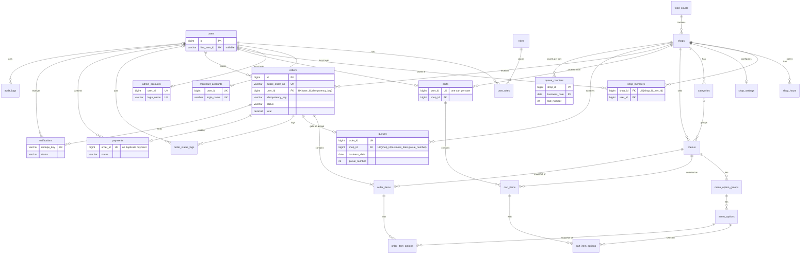

# Q-im ERD (MVP)

แสดงเฉพาะ key หลัก รายละเอียดเต็มอยู่ใน `database/migrations/`

## ข้อสมมติ / Open decisions

> ทุกข้อที่ยังไม่ติ๊กใช้ค่าเริ่มต้นใน [decisions.md](decisions.md) แล้ว เจ้าของโปรเจกต์เปลี่ยนได้ภายหลัง

### จาก CLAUDE.md หัวข้อ 17 (รอเจ้าของโปรเจกต์ยืนยัน)

- [ ] เริ่มใช้กับโรงอาหารมหาวิทยาลัย
- [ ] หนึ่งตะกร้าต่อหนึ่งร้าน (schema ปัจจุบัน: `UNIQUE carts.user_id`)
- [ ] ชำระที่ร้านใน MVP (schema ปัจจุบัน: `PAY_AT_STORE` เท่านั้น)
- [ ] FIFO ตามเวลาที่ร้านยืนยัน
- [ ] ลูกค้ายกเลิกเองได้เฉพาะ `PENDING`
- [ ] UI เขียว/ขาว
- [ ] PHP/MySQL stack
- [ ] Merchant/Admin ใช้ local login
- [ ] AJAX polling
- [ ] QR pickup เป็น optional (ยังไม่มีตาราง)
- [ ] ข้อมูลที่ยังไม่มี: hosting, LINE credentials, payment provider, capacity ของร้าน, นโยบายการดำเนินงาน

### พบระหว่างออกแบบ schema (รอยืนยัน)

- [ ] `shops.capacity` กับ `shop_settings.max_active_orders`: §6 ใช้ capacity ทั้งคำนวณ ETA และจำกัดการรับออเดอร์ ต้องนิยามว่าค่าใดใช้ทำอะไร (ตอนนี้เก็บทั้งสองค่า เป็น NULL ได้ ยังไม่มี logic)
- [ ] วันตัดรอบ `business_date`: เที่ยงคืน Asia/Bangkok หรือเวลาอื่น และยึดวันที่ร้านยืนยันออเดอร์หรือวันที่สั่ง
- [ ] รูปแบบ `public_order_no` (ตอนนี้จองไว้ 32 ตัวอักษร)
- [ ] รูปแบบและค่าของ `shop_members.permissions` (ตอนนี้เป็น TEXT ว่างได้)
- [ ] การอนุมัติร้าน (§5 Admin): `active` เพียงพอ หรือต้องมีสถานะรออนุมัติแยก
- [ ] ออเดอร์ `PENDING` ที่ร้านไม่ตอบ: มีเวลาหมดอายุหรือไม่
- [ ] ออเดอร์ `CANCELLED` หลังชำระแล้ว: ใช้ `REFUNDED` เมื่อใด และใครทำได้
- [ ] LINE Login กับ Messaging API: ใช้ `LINE_CHANNEL_SECRET` ตัวเดียวหรือแยกสองตัว

### ยืนยันแล้ว

- [x] แยก `admin_accounts` จาก `merchant_accounts`
- [x] `merchant_accounts` และ `admin_accounts` เพิ่ม `login_name` (§9 ไม่มีคอลัมน์สำหรับ login)

### ส่วนที่เพิ่มจาก CLAUDE.md หัวข้อ 9

- `active` ใน `categories` และ `menu_option_groups` เพื่อเลิกใช้โดยไม่ลบ
- `shop_settings`, `queue_counters` และ `schema_migrations` ใช้ natural key เป็น PK แทน `id`
- `day_of_week`: 1 = จันทร์ ถึง 7 = อาทิตย์ (ISO-8601)
- `notifications.status`: `PENDING`, `SENDING`, `SENT`, `FAILED`
- ความสัมพันธ์ที่ database ไม่บังคับและ API ต้องตรวจ: เมนูในตะกร้า/ออเดอร์อยู่ร้านเดียวกัน, option เป็นของเมนูนั้น, เงื่อนไข min/max, `COMPLETED` ต้อง `PAID`, ลำดับ transition
